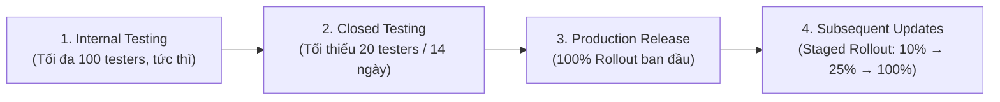

# Hồ sơ Tuân thủ Chính sách Google Play — Fitmate Mobile App

**Mã tài liệu:** POL-PLAY-2026-09-24-v1  
**Ứng dụng:** Fitmate (`vn.fitmate.app`)  
**Nền tảng:** Android (React Native Expo SDK 57, Target SDK 34+)  
**Tài liệu tham chiếu:** [Chính sách Nhà phát triển Google Play](https://support.google.com/googleplay/android-developer/answer/13327111?hl=en) | [Hướng dẫn phát hành Play](https://support.google.com/googleplay/android-developer/answer/9859348?hl=en)

---

## 1. Yêu cầu Xóa tài khoản và Dữ liệu (Account Deletion Web Page Requirement)

Theo chính sách bắt buộc của Google Play hiệu lực từ năm 2023, nếu ứng dụng cho phép người dùng tạo tài khoản, nhà phát triển **bắt buộc** phải cung cấp một đường dẫn trang web công khai (URL) để người dùng có thể yêu cầu xóa tài khoản và dữ liệu liên quan mà **không cần cài đặt lại hoặc mở ứng dụng**.

### 1.1. Địa chỉ Web Xóa tài khoản (Account Deletion Web URL)
- **Đường dẫn chính thức:** `https://fitmate.vn/account-deletion`
- **Tiêu chuẩn kỹ thuật:**
  - Trang web HTTPS mở được bằng mọi trình duyệt hiện đại (Desktop & Mobile Chrome, Safari, Firefox).
  - Giao diện có nhận diện thương hiệu Fitmate rõ ràng (Logo, Header, Contact support).
  - Không nộp raw API endpoint `POST /api/v1/...` làm URL xóa tài khoản trên Google Play Console.

### 1.2. Nội dung Công bố và Hướng dẫn Người dùng
Trang web `https://fitmate.vn/account-deletion` công bố minh bạch 3 nội dung:

1. **Các dữ liệu sẽ bị xóa hoàn toàn:**
   - Thông tin hồ sơ cá nhân (Họ tên, ảnh đại diện, số điện thoại, mật khẩu mã hóa).
   - Kế hoạch tập luyện và nhật ký buổi tập (`WorkoutPlan`, `WorkoutSession`, `WorkoutSetLog`).
   - Nhật ký dinh dưỡng và ảnh chụp bữa ăn (`MealLog`, `NutritionDailyTarget`).
   - Bài đăng mạng xã hội, bình luận, danh sách bạn bè và tin nhắn trao đổi (`Post`, `Comment`, `Friendship`, `DirectMessage`).
   - Mã token thiết bị đẩy thông báo (`DeviceToken`).

2. **Dữ liệu được lưu giữ theo luật định và lý do lưu giữ:**
   - **Dữ liệu tài chính và thanh toán:** Mã giao dịch VNPay, hóa đơn thanh toán gói tập, lịch sử đối soát và chi trả doanh thu PT (`PaymentTransaction`, `PtPayoutOrder`).
   - **Lý do lưu giữ:** Bắt buộc tuân thủ Luật Kế toán Việt Nam, quy định kiểm toán thuế và chứng minh phòng chống gian lận thương mại điện tử.
   - **Thời hạn lưu giữ:** 07 năm kể từ ngày phát sinh giao dịch cuối cùng; sau thời hạn này dữ liệu sẽ được hủy theo lịch trình lưu trữ tự động.

3. **Thời hạn xử lý (Processing SLA):**
   - Tuân thủ baseline hệ thống: **Mục tiêu xử lý hoàn tất yêu cầu xóa trong vòng 30 ngày** kể từ ngày người dùng xác nhận (`Target 30-day processing window`).
   - Hệ thống **không** tự ý thêm "thời gian ân hạn" (grace period) nằm ngoài cam kết dịch vụ; tài khoản sẽ được đánh dấu `PendingDeletion`, thu hồi toàn bộ token đăng nhập và thiết bị ngay khi xác nhận.

### 1.3. Luồng Kỹ thuật Phía sau Form Web
1. Người dùng nhập địa chỉ email đã đăng ký tài khoản Fitmate trên form web `https://fitmate.vn/account-deletion`.
2. Giao diện web gửi request `POST /api/v1/public/account-deletion-request` với payload `{ "email": "user@example.com" }`.
3. Backend kiểm tra sự tồn tại của tài khoản, tạo một token xác thực một lần (HMAC-SHA256, thời hạn 24 giờ) và điều phối email xác nhận qua Outbox pattern. Endpoint trả về HTTP `202 Accepted` trung tính để ngăn dò quét email.
4. Người dùng nhấp vào liên kết xác nhận trong email $\rightarrow$ dẫn đến trang xác nhận và gửi `POST /api/v1/public/account-deletion-confirm` kèm token.
5. Backend xác thực token, chuyển trạng thái người dùng sang `PendingDeletion`, hủy bỏ các phiên đăng nhập đang hoạt động và kích hoạt tiến trình dọn dẹp dữ liệu theo SLA 30 ngày.

---

## 2. Phân loại Nghiệp vụ Thanh toán VNPay (Real-World Physical Service Exemption)

### 2.1. Chính sách Google Play về In-App Billing (IAB)
Google Play quy định: Mọi hàng hóa và dịch vụ kỹ thuật số (Digital Content / Virtual Goods) phân phối trong ứng dụng Android phải thanh toán qua Google Play In-App Billing. Tuy nhiên, các **dịch vụ vật lý ngoài đời thực (Physical Goods & Real-World Services)** được **miễn trừ rõ ràng** khỏi Google Play Billing và được phép sử dụng cổng thanh toán bên thứ ba (như VNPay, thẻ tín dụng, ngân hàng nội địa).

### 2.2. Hồ sơ Phân loại Dịch vụ Huấn luyện Viên Thể hình (PT) của Fitmate
- **Bản chất dịch vụ:** Ứng dụng Fitmate đóng vai trò sàn kết nối (Marketplace). Khách hàng sử dụng ứng dụng để đặt lịch hẹn và thuê Huấn luyện viên Cá nhân (Personal Trainer — PT) để **hướng dẫn tập luyện trực tiếp ngoài đời thực tại các phòng gym / trung tâm thể thao vật lý**.
- **Địa điểm thực hiện:** Phòng tập thể hình thể chất (Offline Gym Facilities), không phải nội dung video kỹ thuật số đóng gói sẵn.
- **Ranh giới tuân thủ:**
  - Khoản thanh toán qua cổng VNPay là chi phí cho buổi tập huấn luyện thể chất trực tiếp giữa hội viên và huấn luyện viên.
  - Các tính năng kỹ thuật số cao cấp (như VIP Subscription hoặc mua AI Tokens) **đã được đóng băng hoàn toàn** (`VipPurchase = false`, `RewardCashout = false` theo **BE-829**). Do đó, ứng dụng không phát sinh bất kỳ giao dịch hàng hóa số nào tại thời điểm phát hành này.
- **Tài liệu nộp giải trình Google Play:** Bản giải trình mô tả dịch vụ offline PT đính kèm giấy chứng nhận nghề nghiệp PT và hình ảnh cơ sở thể thao đối tác khi gửi bản dựng duyệt (App Review).

---

## 3. Khai báo Mục An toàn Dữ liệu (Data Safety Section)

### 3.1. Danh mục Dữ liệu Thu thập và Mục đích Sử dụng

| Loại dữ liệu | Trường dữ liệu cụ thể | Thu thập / Chia sẻ | Mục đích sử dụng | Mã hóa khi truyền tải |
|---|---|---|---|---|
| **Thông tin cá nhân** | Họ tên, Địa chỉ Email, Số điện thoại | Có thu thập, Không chia sẻ bên thứ 3 | Quản lý tài khoản, liên lạc hỗ trợ, xác thực danh tính | **Có (HTTPS / TLS 1.2+)** |
| **Ảnh & Video** | Ảnh bữa ăn, ảnh avatar, ảnh chứng chỉ bằng cấp PT | Có thu thập, Không chia sẻ bên thứ 3 | Ghi nhật ký dinh dưỡng, hiển thị hồ sơ cá nhân, duyệt bằng cấp PT | **Có (HTTPS / TLS 1.2+)** |
| **Sức khỏe & Thể chất** | Cân nặng, chiều cao, bài tập, số set, khối lượng tạ, mục tiêu calo | Có thu thập, Không chia sẻ bên thứ 3 | Theo dõi tiến độ tập luyện, tính toán kế hoạch thể hình | **Có (HTTPS / TLS 1.2+)** |
| **Thông tin Tài chính** | Lịch sử giao dịch đặt lịch, mã tham chiếu ngân hàng | Có thu thập (Mã tham chiếu), Không lưu số thẻ | Đối soát thanh toán dịch vụ PT, xử lý hoàn tiền nếu có sự cố | **Có (HTTPS / TLS 1.2+)** |
| **Định danh thiết bị** | Firebase Cloud Messaging (FCM) Token | Có thu thập, Không chia sẻ | Gửi thông báo đẩy về lịch tập, tin nhắn chat và cập nhật hệ thống | **Có (HTTPS / TLS 1.2+)** |

### 3.2. Quyền Truy cập Ứng dụng (App Permissions Inventory)

Các quyền runtime được định nghĩa trong `AndroidManifest.xml` của Android app (`FitmateAI_FE/mobile`):

1. `android.permission.INTERNET`: Bắt buộc để giao tiếp với Backend API qua HTTPS.
2. `android.permission.ACCESS_NETWORK_STATE`: Kiểm tra trạng thái mạng để xử lý chế độ offline và hiển thị cảnh báo mất kết nối.
3. `android.permission.CAMERA`: Cho phép người dùng chụp ảnh món ăn ghi nhận nhật ký calo và huấn luyện viên chụp bằng cấp chứng chỉ chuyên môn.
4. `android.permission.READ_MEDIA_IMAGES` (hoặc System Photo Picker trên Android 13+): Chọn ảnh có sẵn từ thư viện ảnh thiết bị mà không cần truy cập toàn bộ bộ nhớ.
5. `android.permission.POST_NOTIFICATIONS`: Yêu cầu quyền hiển thị thông báo đẩy trên Android 13+ (API 33+).

**Cam kết về quyền riêng tư:**
- **Không yêu cầu quyền vị trí nền (`ACCESS_BACKGROUND_LOCATION`)**.
- **Không yêu cầu quyền vị trí chính xác (`ACCESS_FINE_LOCATION`)**.
- **Không thu thập Mã định danh quảng cáo (Google Advertising ID - AAID)**; không tích hợp AdMob hoặc SDK theo dõi quảng cáo của bên thứ ba.

---

## 4. Lộ trình và Quy định Phát hành Google Play Console

> [!IMPORTANT]
> **Quy định của Google Play về Phát hành Lần đầu:**  
> Google Play Console **không hỗ trợ** phát hành theo tỷ lệ phần trăm (Staged Rollout như 5%, 25%) cho **lần phát hành Production đầu tiên** của một gói ứng dụng hoàn toàn mới. Tỷ lệ % chỉ áp dụng cho các bản cập nhật phiên bản tiếp theo.  
> Do đó, quy trình phát hành bắt buộc phải qua các đường đua thử nghiệm có kiểm soát:

### 4.1. Đường đua 1: Thử nghiệm Nội bộ (Internal Testing Track)
- **Mục tiêu:** Bàn giao bản dựng ký Android App Bundle (`.aab`) cho đội ngũ dự án, QA và Operator.
- **Giới hạn:** Tối đa 100 testers được chỉ định qua danh sách email Google Group.
- **Thời gian phân phối:** Có hiệu lực trong vòng vài phút sau khi tải lên, không cần Google xét duyệt thủ công.

### 4.2. Đường đua 2: Thử nghiệm Đóng (Closed Testing Track)
- **Quy định Google Play cho tài khoản cá nhân mới:** Bắt buộc duy trì tối thiểu 20 kiểm thử viên đã đăng ký tham gia liên tục trong ít nhất 14 ngày trước khi được cấp quyền đăng ký phát hành Production.
- **Tiêu chí nghiệm thu:** Không phát sinh sự cố văng app (ANR/Crash rate < 0.47%), luồng UAT core hoàn tất không lỗi P0/P1.

### 4.3. Đường đua 3: Phát hành Chính thức (Production Track)
- Chỉ gửi yêu cầu phát hành bản dựng Production (100% rollout) sau khi:
  1. Toàn bộ 10 Release Gates (G1..G10) đạt trạng thái **PASS**.
  2. Trang web `https://fitmate.vn/account-deletion` đã hoạt động thực tế trên internet.
  3. Operator đã ký duyệt văn bản phê duyệt phát hành chính thức.
