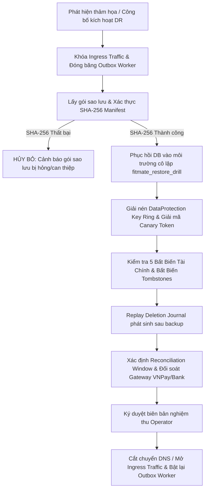

# Sổ Tay Vận Hành Phục Hồi Thảm Họa (Disaster Recovery Runbook)

Tài liệu này quy định quy trình chuẩn (SOP) để sao lưu, kiểm tra định kỳ, và phục hồi hệ thống backend Fitmate khi xảy ra thảm họa phần cứng, hư hỏng trung tâm dữ liệu hoặc mất mát dữ liệu nghiêm trọng theo chuẩn **BR-16** và **BE-825**.

---

## 1. Cam Kết Dịch Vụ và Mục Tiêu Phục Hồi (SLA / RPO / RTO)

| Chỉ số | Mục tiêu cam kết | Ý nghĩa kỹ thuật |
| :--- | :--- | :--- |
| **RPO (Recovery Point Objective)** | **<= 24 giờ** | Lượng dữ liệu tối đa chấp nhận mất mát. Sao lưu full tự động diễn ra lúc 02:00 UTC hàng ngày. |
| **RTO (Recovery Time Objective)** | **<= 4 giờ (14,400 giây)** | Tổng thời gian từ khi công bố thảm họa, lấy bản sao lưu, khôi phục DB/keys, kiểm chứng bất biến, đối soát tài chính đến khi mở lại traffic. |
| **Bảo vệ môi trường Production** | **Tuyệt đối không restore đè** | Diễn tập và kiểm chứng sơ bộ bắt buộc thực hiện trên môi trường cô lập (`fitmate_restore_drill`). Chỉ cắt chuyển production sau khi có biên bản ký duyệt của Operator. |

---

## 2. Kiến Trúc Gói Sao Lưu 3 Thành Phần (Tri-Component Backup)

Gói sao lưu hoàn chỉnh của Fitmate bao gồm 3 thành phần vật lý độc lập được liên kết và xác thực bằng `manifest.json`:

1. **Cơ sở dữ liệu PostgreSQL (`fitmate_db.dump`)**:
   - Sử dụng định dạng nhị phân nén của PostgreSQL (`pg_dump -Fc`).
   - Tạo ra một transaction snapshot nhất quán tại thời điểm `SnapshotTimestampUtc`.
2. **Khóa mã hóa DataProtection Key Ring (`dpkeys.tar.gz`)**:
   - Chứa toàn bộ các file khóa XML của ASP.NET Core DataProtection được lưu trong volume `fitmate-dpkeys`.
   - Phục vụ giải mã: Push delivery tokens (FCM/Expo), Account deletion tokens, Email confirm & password reset tokens.
3. **Tài nguyên Media tĩnh (`media.tar.gz`)**:
   - Chứa chứng chỉ huấn luyện viên PT, ảnh hồ sơ và tài liệu upload của người dùng.
4. **Manifest Xác Thực Toàn Vẹn (`manifest.json`)**:
   - Lưu trữ mốc snapshot UTC, schema version, kích thước, và mã băm SHA-256 độc lập của từng file.

### Quy tắc phối hợp (Coordination Rule)
* Cơ sở dữ liệu PostgreSQL là **Mốc chân lý tối cao (Authoritative Baseline)**.
* Gói DataProtection Key Ring và Media uploads phải bao phủ toàn bộ các entity được tham chiếu bởi snapshot DB tại mốc `SnapshotTimestampUtc`.

---

## 3. Quy Trình Khôi Phục Thảm Họa (Step-by-Step Restoration)



### Bước 1: Khóa Ingress Traffic và Đóng Băng Outbox Worker (Bắt buộc)
> [!CAUTION]
> **Tuyệt đối không để Outbox Worker chạy tự động ngay sau khi khôi phục dữ liệu!**
> Nếu worker tự động quét và gửi lại hàng loạt các tin nhắn outbox cũ, hệ thống sẽ gây ra:
> - Gửi trùng thông báo push / email tới người dùng.
> - Phát sinh các yêu cầu thanh toán / webhook trùng lặp tới bên thứ ba.
> - Tác vụ ghi của người dùng mới có thể xung đột với dữ liệu đang cần đối soát.

1. Chặn toàn bộ traffic ghi từ bên ngoài tại API Gateway / Load Balancer (chuyển sang trang bảo trì 503 Maintenance Mode).
2. Dừng background service outbox dispatcher trong cấu hình hoặc gán `FEATURE_PUSH_ENABLED=false`.

### Bước 2: Xác thực tính toàn vẹn gói sao lưu (Fail-Fast Verification)
Chạy kiểm tra chữ ký băm SHA-256 của từng file thành phần so với `manifest.json`. Nếu có bất kỳ sự sai lệch nào (dù chỉ 1 bit), dừng toàn bộ quy trình ngay lập tức.

### Bước 3: Phục hồi Database vào môi trường cô lập
1. Tạo database độc lập `fitmate_restore_drill`.
2. Khôi phục schema và dữ liệu thông qua lệnh `pg_restore`:
   ```bash
   pg_restore --clean --if-exists --no-owner --no-privileges -U fitmate -d fitmate_restore_drill /path/to/fitmate_db.dump
   ```

### Bước 4: Kiểm chứng DataProtection Key Ring (Canary Decryption)
1. Giải nén `dpkeys.tar.gz` vào thư mục tạm được bảo vệ.
2. Kiểm tra các file `key-*.xml` tồn tại và hợp lệ.
3. Nạp `IDataProtectionProvider` trỏ vào thư mục key vừa khôi phục và tiến hành giải mã token mẫu (Canary Token). Quá trình giải mã phải trả về đúng plaintext ban đầu mà không ném `CryptographicException`.

### Bước 5: Kiểm chứng 5 Bất Biến Tài Chính Sau Khôi Phục (Financial Invariants)
Thực thi bộ câu lệnh SQL kiểm tra trên database vừa restore:
1. **Non-negative amounts**:
   ```sql
   SELECT COUNT(*) FROM payments WHERE "AmountVnd" < 0 OR "RefundedSoFarVnd" < 0;
   -- Kết quả bắt buộc: 0
   ```
2. **Refund Cap Invariant**:
   ```sql
   SELECT COUNT(*) FROM payments WHERE "RefundedSoFarVnd" > "AmountVnd";
   -- Kết quả bắt buộc: 0
   ```
3. **Cumulative Refund Invariant**:
   ```sql
   SELECT COUNT(*) FROM (
       SELECT p.id, p."AmountVnd", COALESCE(SUM(r."AmountVnd"), 0) AS total_refunded
       FROM payments p
       LEFT JOIN refunds r ON r."PaymentId" = p.id AND r."Status" = 1
       GROUP BY p.id, p."AmountVnd"
       HAVING COALESCE(SUM(r."AmountVnd"), 0) > p."AmountVnd"
   ) violations;
   -- Kết quả bắt buộc: 0
   ```
4. **Unique ProviderTxnRef**:
   ```sql
   SELECT COUNT(*) FROM (
       SELECT "ProviderTxnRef", COUNT(*) 
       FROM payments 
       WHERE "ProviderTxnRef" IS NOT NULL AND "ProviderTxnRef" <> ''
       GROUP BY "ProviderTxnRef" 
       HAVING COUNT(*) > 1
   ) dups;
   -- Kết quả bắt buộc: 0
   ```
5. **Appointment-Payment Integrity**:
   ```sql
   SELECT COUNT(*) 
   FROM appointments a 
   WHERE a."PaymentId" IS NOT NULL 
     AND NOT EXISTS (SELECT 1 FROM payments p WHERE p.id = a."PaymentId");
   -- Kết quả bắt buộc: 0
   ```

### Bước 6: Tái áp dụng Deletion Journal (Bảo vệ quyền riêng tư)
> [!IMPORTANT]
> Đối với người dùng đã yêu cầu xóa tài khoản trong khoảng thời gian từ sau `SnapshotTimestampUtc` đến khi xảy ra sự cố:
> - Nạp file nhật ký xóa độc lập `deletion_journal.json`.
> - Thực thi cập nhật lại trạng thái xóa:
>   ```sql
>   UPDATE asp_net_users SET "DeletedAt" = @deletedAt WHERE "Id" = @userId;
>   ```
> - Bảo đảm người dùng đã xóa không bị hồi sinh trái phép khi hệ thống online trở lại.
> - *Ghi chú*: Nếu chưa cấu hình nguồn lưu trữ deletion journal độc lập, bước này ghi nhận trạng thái **`BLOCKED (Operator OPS-06)`**.

### Bước 7: Đối soát vùng thời gian mất mát (Lost-Work Boundary & Reconciliation)
1. Xác định chính xác khoảng thời gian cần đối soát:
   `Reconciliation Window = [SnapshotTimestampUtc -> IncidentTimestampUtc]`.
2. **Xử lý thanh toán**:
   - Truy xuất danh sách giao dịch từ cổng thanh toán đối tác (VNPay / Ngân hàng) trong khoảng thời gian này.
   - Đối chiếu với các bản ghi `payments` trong database.
   - Với các giao dịch tiền đã trừ tại ngân hàng nhưng chưa có trong DB: Admin tạo lệnh hoàn tiền trực tiếp cho khách hoặc cập nhật bổ sung đơn hàng có ghi nhận `AuditLog`.
3. **Xử lý Idempotency Records bị mất**:
   - Nhận thức rõ ràng các `idempotency_records` sinh ra trong khoảng thời gian mất mát đã không còn trong DB.
   - Cấm client tự ý retry tạo giao dịch mới mà chưa kiểm tra trạng thái cũ qua cổng thanh toán.

### Bước 8: Mở lại Traffic và Kích hoạt Hệ Thống
Sau khi các bất biến đạt 100% và đối soát hoàn tất:
1. Operator ký biên bản nghiệm thu khôi phục.
2. Cắt chuyển kết nối ứng dụng sang database chính thức.
3. Kích hoạt lại API Ingress traffic cho client.
4. Bật lại outbox worker để xử lý các event mới.

---

## 4. Chính Sách Lưu Trữ (Retention Policy) và Cảnh Báo Quá Hạn

* **Lịch sao lưu**:
  - Full Backup: Tự động chạy mỗi ngày lúc **02:00 UTC** (`scripts/backup.ps1`).
* **Thời gian lưu giữ (Retention Window)**:
  - Bản sao lưu hàng ngày (Daily): Lưu trữ **30 ngày**.
  - Bản sao lưu cuối tháng (Monthly): Lưu trữ **12 tháng**.
  - Bản sao lưu cuối năm (Annual): Lưu trữ **7 năm** (tuân thủ luật kế toán và thanh tra tài chính).
* **Cảnh báo giám sát (Staleness Alert)**:
  - Metric OpenTelemetry: `fitmate_backup_freshness_hours`.
  - Nếu tuổi của bản backup thành công gần nhất > **24 giờ**, hệ thống Prometheus/Alertmanager tự động phát cảnh báo **P1 (BackupFreshnessCritical)** tới đội ngũ On-Call.

---

## 5. Trạng Thái Các Phụ Thuộc Ngoại Vi (External Blockers)

| Mã phụ thuộc | Nội dung | Trạng thái hiện tại | Hành động tiếp theo |
| :--- | :--- | :--- | :--- |
| **OPS-04** | Offsite Cold Storage (S3 / GCS bucket) | `BLOCKED` | Chờ Operator cấp bucket S3 có IAM policy cô lập và bật Object Lock (WORM). |
| **OPS-05** | KMS / HSM Key Custody cho Backup & DataProtection | `BLOCKED` | Chờ Operator cấu hình dịch vụ quản lý khóa trên Cloud KMS để mã hóa bản backup at-rest. |
| **OPS-06** | Nguồn lưu trữ độc lập Deletion Journal Stream | `BLOCKED` | Chờ Operator thiết lập kho lưu trữ log xóa tài khoản độc lập ngoài cơ sở dữ liệu chính. |
| **OPS-03** | Sandbox / Production API VNPay Reconciliation | `BLOCKED` | Chờ Operator cung cấp tài khoản merchant API để tự động hóa đối soát giao dịch gateway. |

