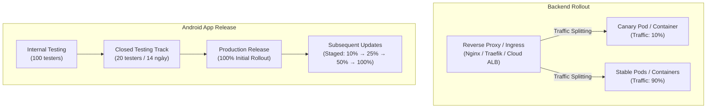

# Runbook: Quy trình Triển khai Phân kỳ và Kế hoạch Hoàn nguyên (Staged Rollout & Rollback)

**Mã tài liệu:** RB-ROLLOUT-2026-09-24-v1  
**Phạm vi áp dụng:** Hệ thống Backend API Fitmate, Cổng Quản trị FitmateWebApp và Ứng dụng Android Fitmate  
**Tài liệu liên quan:** [Runbook Disaster Recovery](disaster-recovery.md) | [Quy tắc Bất biến Tài chính](../domain-rules.md) | [Hồ sơ Tuân thủ Play](../google-play-compliance.md)

---

## 1. Nguyên tắc Phân tách Triển khai Giữa Backend và Mobile App

> [!IMPORTANT]
> **Đặc tính kỹ thuật bất đối xứng giữa Backend và Mobile App:**  
> 1. **Khả năng thu hồi:** Backend container có thể chuyển hướng lưu lượng (traffic reroute) hoặc hoàn nguyên phiên bản trong vài giây. Ngược lại, một khi bản dựng ứng dụng di động Android đã được người dùng tải xuống thiết bị, **không có cách nào ép buộc gỡ cài đặt hay hạ cấp phiên bản từ xa**. Việc bấm dừng phát hành (Halt Rollout) trên Google Play Console chỉ ngăn không cho người dùng mới cập nhật tiếp, chứ không xóa ứng dụng trên máy của những người đã cập nhật.  
> 2. **Yêu cầu tương thích ngược (Backward Compatibility):** Backend API bắt buộc phải luôn duy trì khả năng tương thích ngược với các phiên bản ứng dụng Android cũ đang lưu hành ngoài thị trường, trừ khi kích hoạt cơ chế Force Update thông qua endpoint kiểm tra phiên bản.  
> 3. **Quy định Google Play:** Không hỗ trợ staged rollout cho bản phát hành Production đầu tiên (bắt buộc 100% sau khi qua Closed Testing). Phân kỳ phần trăm trên Play chỉ áp dụng cho các bản cập nhật sau đó.

---

## 2. Các Ngưỡng Dừng Khẩn cấp (Halting / Abort Thresholds)

Mỗi nấc điều chỉnh lưu lượng (traffic step) trên Backend hoặc mỗi giai đoạn phân phối Mobile App bắt buộc phải trải qua **Cửa sổ đánh giá tối thiểu 5 phút (5-minute evaluation window)**.  
Nếu vi phạm bất kỳ tiêu chí nào dưới đây, Operator phải lập tức **DỪNG TRIỂN KHAI (HALT)** và kích hoạt quy trình xem xét hoàn nguyên:

| Mã chỉ số | Tên chỉ số giám sát | Ngưỡng vi phạm dừng khẩn cấp | Cửa sổ đánh giá | Hành động phản ứng tức thì |
|---|---|---|---|---|
| **TH-01** | Tỷ lệ lỗi HTTP 5xx bất thường | **> 1.0%** trên tổng số requests | 5 phút liên tục | Dừng tăng traffic canary; chuyển hướng 100% về stable image |
| **TH-02** | Độ trễ đọc cốt lõi (Core Reads p95) | **> 500 ms** (GET `/users/me`, `/workouts`, `/trainers`) | 5 phút liên tục | Kiểm tra chỉ mục database, connection pool |
| **TH-03** | Độ trễ ghi cốt lõi (Core Writes p95) | **> 1000 ms** (POST `/bookings`, `/payments/orders`) | 5 phút liên tục | Kiểm tra khóa hàng đợi DB / lock contention |
| **TH-04** | Sai lệch Bất biến Tài chính | **Sai lệch số dư > 0 VNĐ** (Ledger Discrepancy) | Phát hiện tức thì | **DỪNG TẤT CẢ GIAO DỊCH CHECKOUT**; đóng băng cổng thanh toán |
| **TH-05** | Bão hòa Kết nối Cơ sở dữ liệu | **> 85%** connection pool hoặc wait time > 200ms | 3 phút liên tục | Dừng scale traffic, giải phóng connection rò rỉ |
| **TH-06** | Hàng đợi Sự kiện Outbox bị ứ đọng | Dead-letter queue tăng đột biến > 10 items | 5 phút liên tục | Cách ly message lỗi, bảo lưu transaction gốc |

---

## 3. Các Chiến lược Hoàn nguyên (Rollback Strategies)

Tùy thuộc vào bản chất sự cố và tính chất của việc thay đổi cơ sở dữ liệu (Database Schema), Operator chọn một trong ba chiến lược sau:

### 3.1. Chiến lược 1: Hoàn nguyên Container Image Tương thích (Compatible Image Rollback)
- **Điều kiện áp dụng:** Sự cố phát sinh do lỗi logic mã nguồn backend, nhưng thay đổi cơ sở dữ liệu là **tương thích ngược hoàn toàn (Additive Schema / Expand Phase)** — ví dụ: chỉ thêm cột mới có giá trị mặc định, thêm bảng mới, không xóa hay đổi tên cột cũ.
- **Quy trình thực hiện:**
  1. Operator thực hiện điều chỉnh cấu hình Ingress / Reverse Proxy: chuyển toàn bộ 100% lưu lượng về nhóm container chạy image ổn định trước đó (ví dụ: `fitmate-api:1.0.0-previous`).
  2. Thời gian gián đoạn: **0 giây (Zero Downtime)**.
  3. Cơ sở dữ liệu giữ nguyên cấu trúc mới; không chạy lệnh `dotnet ef database update <migration_cũ>` vì migration cũ có thể phá hủy dữ liệu mới phát sinh.

### 3.2. Chiến lược 2: Triển khai Khắc phục Nhanh về phía trước (Rollforward Hotfix)
- **Điều kiện áp dụng:** Lỗi nhỏ phát hiện trên cấu hình môi trường, biến môi trường (missing env var), hoặc lỗi cú pháp nhỏ có thể vá được trong vòng dưới 15 phút.
- **Quy trình thực hiện:**
  1. Tạo hotfix commit trên nhánh release.
  2. Kích hoạt quy trình CI/CD build image mới (ví dụ: `fitmate-api:1.0.1-hotfix`).
  3. Kiểm tra kiểm thử tự động trên runner; deploy bản vá thay thế canary container.

### 3.3. Chiến lược 3: Phục hồi Thảm họa kèm Đối soát Sổ cái (Disaster Recovery & Ledger Reconciliation)
- **Điều kiện áp dụng:** Phát hiện sự cố phá hủy cấu trúc dữ liệu nghiêm trọng, rò rỉ dữ liệu hoặc sai lệch bất biến số dư tài chính không thể khôi phục qua application logic.
- **Quy trình thực hiện theo [Runbook Disaster Recovery](disaster-recovery.md):**
  1. Operator ban hành lệnh dừng khẩn cấp toàn bộ lưu lượng API (bật chế độ bảo trì `503 Service Unavailable`).
  2. Phục hồi cơ sở dữ liệu PostgreSQL từ bản sao lưu Point-In-Time gần nhất (RPO $\le$ 24h, RTO $\le$ 4h).
  3. **Bước bắt buộc — Đối soát sổ cái giao dịch:**
     - Chạy script kiểm tra đối chiếu bảng `PaymentTransactions` trong cơ sở dữ liệu vừa phục hồi với nhật ký giao dịch thực tế từ cổng thanh toán VNPay (qua file đối soát IPN / merchant portal).
     - Bổ sung các bản ghi giao dịch thành công đã thanh toán trong khoảng thời gian giữa snapshot sao lưu và thời điểm gặp sự cố.
     - Đảm bảo quyền lợi khách hàng đã trừ tiền và doanh thu huấn luyện viên không bị thất thoát.
  4. Mở lại lưu lượng hệ thống sau khi có chữ ký xác nhận của Incident Commander.

---

## 4. Bảng Phân nhiệm và Thẩm quyền Quyết định (Decision Roles)

| Vai trò | Nhân sự đảm nhiệm | Thẩm quyền và Trách nhiệm |
|---|---|---|
| **Incident Commander (Chỉ huy sự cố)** | Trưởng bộ phận Kỹ thuật / Operator trưởng | - Người duy nhất có thẩm quyền ra lệnh Dừng triển khai hoặc Kích hoạt Hoàn nguyên. - Chỉ đạo phối hợp giữa đội Backend, Frontend và Vận hành. |
| **Backend Release Engineer** | Backend Tech Lead / Developer | - Giám sát chỉ số kỹ thuật (5xx rate, p95 latency, DB pool). - Thực thi chuyển hướng traffic trên Ingress/Load Balancer. - Thực hiện rollback image container. |
| **Database Administrator (DBA)** | Lead DevOps / DBA | - Đánh giá tính toàn vẹn của dữ liệu và schema. - Thực hiện snapshot backup trước khi thao tác; kích hoạt quy trình DR nếu có lệnh. |
| **QA / UAT Lead** | Trưởng nhóm Kiểm thử | - Theo dõi báo cáo sự cố từ người dùng và kiểm thử viên trên Closed Testing Track. - Cung cấp bằng chứng lỗi (reproduction steps, logs) cho Incident Commander. |

---

## 5. Bảng Kiểm Tra Thao tác Từng Bước (Operational Checklist)

- [ ] **Trước khi triển khai:**
  - [ ] Đã hoàn tất sao lưu Snapshot PostgreSQL trước deployment.
  - [ ] Đã xác minh digest của cả image mới và image trước đó sẵn sàng trong Container Registry.
  - [ ] Đã mở sẵn dashboard giám sát Prometheus / Grafana / CloudWatch theo dõi 5 chỉ số ngưỡng dừng.
- [ ] **Trong quá trình triển khai Canary (10% traffic):**
  - [ ] Quan sát trong đủ 5 phút.
  - [ ] Tỷ lệ 5xx < 1%? (Đạt / Không đạt)
  - [ ] p95 Reads < 500ms? (Đạt / Không đạt)
  - [ ] Không có báo cáo sai lệch số dư tài chính? (Đạt / Không đạt)
- [ ] **Trường hợp vi phạm ngưỡng:**
  - [ ] Incident Commander hô lệnh HALT.
  - [ ] Reroute 100% traffic về image stable trước đó.
  - [ ] Thông báo cho đội ngũ hỗ trợ khách hàng và ghi nhận nhật ký sự cố.

